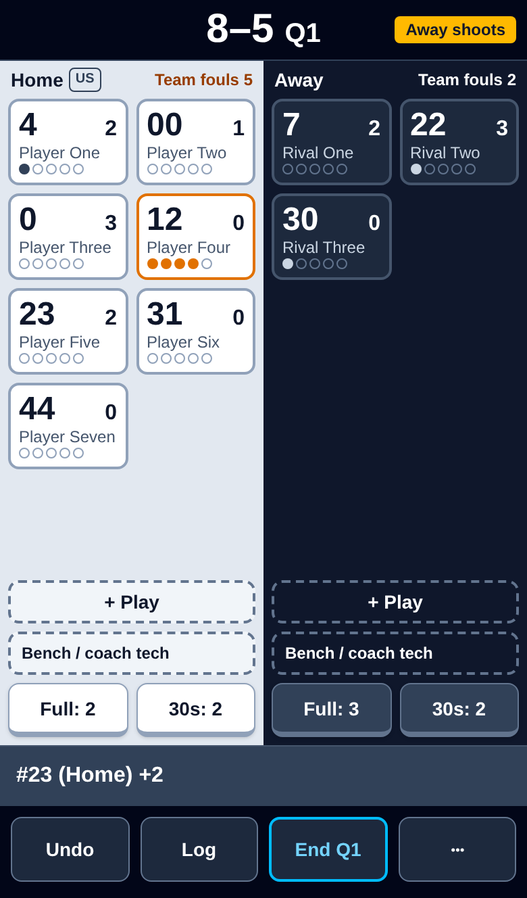

# Bench Book

A free, open-source phone app for the person keeping the scorebook at a junior high basketball
game. Tap in both teams' points, fouls and timeouts as they happen (or just your own team's),
check the app against the paper book at the end of each quarter, and download CSV files that pair
with the book page after the game.

The paper scorebook stays the official record. Bench Book sits beside it.

**Open it:** <https://quiet-swan-ee2365.netlify.app>. To look around without a real roster, add
`?demo` to the address: <https://quiet-swan-ee2365.netlify.app/?demo>.



- No login, no server. Everything stays on your phone.
- Works offline once loaded.
- Rules: IESA / NFHS (team fouls reset each quarter, bonus on the 5th).
- Status: 1.0. It has been used beside the paper book at real games, keeping both teams.

## Contents

- [Put it on your phone](#put-it-on-your-phone)
- [How a game works](#how-a-game-works)
- [What it does not do](#what-it-does-not-do)
- [Privacy](#privacy)
- [Development](#development)
- [Project docs](#project-docs)
- [License](#license)

## Put it on your phone

Open the link above in the phone's browser while you have a connection. After that first load,
the app works with no signal.

- **iPhone or iPad:** in Safari, tap **Share**, then **Add to Home Screen**. Open Bench Book from
  the home screen icon from then on. Your roster stays saved between games.
- **Android:** in Chrome, open the menu and choose **Add to Home screen** (or **Install app**).

When a new version is ready, Setup shows an **Update available — reload** button. Nothing updates
in the middle of a game unless you tap it.

**How to use**, under the ⋯ button, explains everything below in the app, with screenshots.

## How a game works

1. **Setup.** Pick Home or Away and enter your roster (number and name), and the other team's
   roster under it (numbers, names optional) if you keep both teams. Both rosters are optional.
   Tap **Start game**. **Game details** holds the opponent (left blank, the game is named for its
   date, MM-DD), the date, your team name, the coach, scorer and timekeeper. Your roster is saved
   on the phone for next time; theirs is not. ⋯ → **Edit teams** fixes a number, adds a name or
   adds a player mid-game.
2. **Live.** Home is on the left with light cards, Away on the right with dark ones, and a small
   **US** tag marks your team (⋯ → Experiments → **Our team on the left** puts yours on the left
   either way; the colors stay with Home and Away). A team name you entered heads its half, under
   a small Home or Away (the opponent's date default, MM-DD, is not shown as a name). Tap any
   player card on either team, then `+2`, `+3`, `FT made`, `FT missed`, `Foul` or `Tech foul`.
   Each half ends with a dashed **+ Play** card for a play with no card: pick the play, then
   **Whose number?** credits a typed number (adding a new one to that team), or **No number**
   records it for the team only. Under it are the team's **Bench / coach tech** card and its
   timeout buttons (`Full: 3`, `30s: 2`, plus `OT` in overtime), each showing what is left; one at
   zero asks first. **Undo**, **Book**, **End Q** and **⋯** are on the bottom bar. One line above
   the bar shows what was just entered, naming the team, and stays until the next entry, with a
   chip at its right for a quarter still to check.
3. **Subs (optional).** Every card looks the same; the five on the floor lead, and the cards after
   them are a shade grayer (Home) or darker (Away). Each team's first five start (the
   **Starters** button, beside + Play, changes them before that team's first play). A bench player
   who makes a play goes on the floor on their own, so nothing is lost by skipping a sub, and a
   foul-out takes the player off. Their card also trades places with the top-five card whose last
   play is oldest (a fouled-out one first), but only once you stop tapping for about 8 seconds, so
   a card never moves under your thumb; a recorded sub shows at once. For a sub, tap the player
   checking in, then **#22 checks in** on their sheet, then who went out. The **Sub** button
   (always gray) asks **Who went out?** (with a quiet "longest without a play" hint), **Who came
   in?** or, for a line change, **Who's on the floor?**. Subs change no score or count and are in
   neither CSV.
4. **Fix mistakes.** Undo right away (Redo puts back one undone too many), or open **Book**, then
   **Plays** and tap a row: it opens the fix, where you change the play, the team, the player or
   the quarter, or delete it. **Book → Players** shows each player's points and fouls by quarter,
   for either team, like the book's rows; tap a quarter cell to list that player's plays there,
   fix one, or add a missing play to that quarter (a 5th foul added late says Tell the official).
5. **Check each quarter.** **End Q1** advances at once. When there is time, tap the check chip,
   enter the game score after the quarter from the book's running score, and the app checks the
   quarter's own points against its plays. Their score, if you type it, only warns when it is
   off. **Add play** stays on the check after the score matches, for a foul the book has and the
   app doesn't. You can leave the check for later.
6. **Final.** After Q4, choose Start overtime or End game (no overtime). The **Final** screen
   lists any quarter not yet checked, ends a game early with a confirm, and **Reopen game** puts
   an ended game back in play.
7. **Export.** From Final, download the Book CSV (pairs with the paper book page, with a block
   for each team you recorded; plays with no number get a "No number" row, so each block adds
   up) and the Plays CSV (every entry, in order, each marked Home or Away). A separate Usage CSV
   counts taps and fixes for the game, with no names.

**Experiments**, under ⋯, holds settings that may change or go away: **Our team on the left**,
and an opt-in **Timeout clock** (off by default) that counts down 60 or 30 seconds when a timeout
is taken. On Android the phone buzzes at half time and at 0; iPhone browsers don't let a web app
vibrate, so there the clock is silent.

**Demo mode.** Add `?demo` to the address to open Setup with both rosters filled with invented
players, for trying the app or showing it off. Demo keeps its own saved game and rosters, so a
real roster or game on that phone is never touched; a gray **Demo** strip shows at the top, and
⋯ → **Reset demo** starts it over.

## What it does not do

- It is not the official record. If the app and the book disagree, the book wins; the quarter
  check is there to find the difference.
- No game clock or shot clock. The only clock is the optional timeout countdown.
- No missed field goals, rebounds, assists, turnovers, steals or blocks.
- One rule set, IESA / NFHS. Other rules can't be configured.
- No syncing between phones and no backup. A game lives on the one phone it was entered on, and
  is cleared 72 hours after its last change, so download the CSVs before then. The saved roster
  is kept.
- No comparing with the other team's scorer, and no posting or sharing results from the app.

Some of these are ideas for later; see [`docs/backlog.md`](docs/backlog.md).

## Privacy

Nothing leaves the phone. There is no server, no account, no analytics and no third-party
scripts or fonts. Roster names and game data live in the browser's local storage only. The CSV
files are written only when you tap to download them, and go wherever your phone saves downloads.

## Development

**Stack:** [Astro](https://astro.build) 7 (static output) with [Preact](https://preactjs.com)
components, Tailwind CSS 4, TypeScript, and `@vite-pwa/astro` (Workbox) for the offline service
worker. Tests use [Vitest](https://vitest.dev) and [Playwright](https://playwright.dev).
Package manager: pnpm.

```bash
pnpm install
pnpm dev         # dev server
pnpm dev:demo    # dev server opened at /?demo: both rosters filled with invented players, in demo's own storage
pnpm build       # static build to dist/
pnpm preview     # serve the built site
pnpm test        # unit tests (vitest)
pnpm test:e2e    # scripted games in a real browser (Playwright, iPhone 13 profile); the bonus game prints taps per quarter
pnpm check       # the per-commit gate: astro check, tsc, unit tests
pnpm howto:shots # refresh the How-to screenshots in public/howto/ (pnpm release runs it)
```

The first `pnpm test:e2e` run needs the browser once: `pnpm exec playwright install chromium`.

**Layout:**

| Path | What's there |
|---|---|
| `src/core/` | Game logic with no UI: the play list, totals derived from it, the quarter check, lineup, storage, CSV export |
| `src/ui/` | Preact screens and sheets; the testable logic for each sits beside it in `*-logic.ts` |
| `src/ui/howto-content.ts` | The in-app How-to text |
| `src/pages/index.astro` | The one page |
| `e2e/` | Playwright games played through the real interface |
| `scripts/` | The release script, the How-to screenshot run, and UX-audit helpers |
| `docs/` | Backlog, color rules, design specs and plans, audit reports |

**Tests.** Unit tests sit next to the code as `*.test.ts`. The Playwright specs in `e2e/` build
the site and play scripted games on an iPhone 13-sized screen, checking the screen and the
exported CSVs. Test data and screenshots use invented names only.

**Releases.** Changes are listed in [`CHANGELOG.md`](CHANGELOG.md) (Keep a Changelog). New
user-visible work gets a bullet under `## [Unreleased]`. A release is cut with
`pnpm release <patch|minor|major>`: it runs `pnpm check`, the full e2e suite and the How-to
screenshots, then bumps `package.json`, moves the Unreleased bullets under the new version,
commits and tags. It never pushes. Version numbers follow the product's phases (0.x on the way to
1.0, 2.0 and 3.0 for the later phases); `CLAUDE.md` has the details.

**Deploy.** Pushing `master` deploys to Netlify (build `pnpm build`, publish `dist`, from
`netlify.toml`).

**UX audit.** At milestones, a first-time-user audit plays a scripted game blind in a phone-sized
browser and writes a report to `docs/ux-audit/reports/`. It runs as the `/ux-audit` Claude Code
skill in `.claude/skills/ux-audit/`.

### Contributing

Bug reports from real games are the most useful thing. If you open an issue, describe what you
tapped and what the screen showed; please don't attach a CSV with real players' names.

For code changes:

- Run `pnpm check`, and `pnpm test:e2e` for any change to the interface or `e2e/`.
- Use invented names only in tests, fixtures and screenshots. The repo is public.
- Follow the color rules in [`docs/colors.md`](docs/colors.md): each color has one job.
- Write US English, and keep player wording gender-neutral.
- Add a `CHANGELOG.md` bullet under `## [Unreleased]` for anything a scorer would notice.

`CLAUDE.md` holds the working rules the maintainer and their coding assistant follow.

## Project docs

- [`docs/backlog.md`](docs/backlog.md): what might come next, with the reasons and triggers.
- [`docs/colors.md`](docs/colors.md): what each color means in the interface.
- [`docs/superpowers/specs/`](docs/superpowers/specs/): design specs, starting with
  [`2026-11-10-bench-book-v1-design.md`](docs/superpowers/specs/2026-11-10-bench-book-v1-design.md).
- [`docs/ux-audit/reports/`](docs/ux-audit/reports/): first-time-user audit reports.

The product is built in phases. Phase 1 (1.0) is a companion to the paper book. Phase 2 would
update the book after each quarter from the app, and Phase 3 would let the app replace the book.
Neither has a date.

## License

[MIT](LICENSE).
